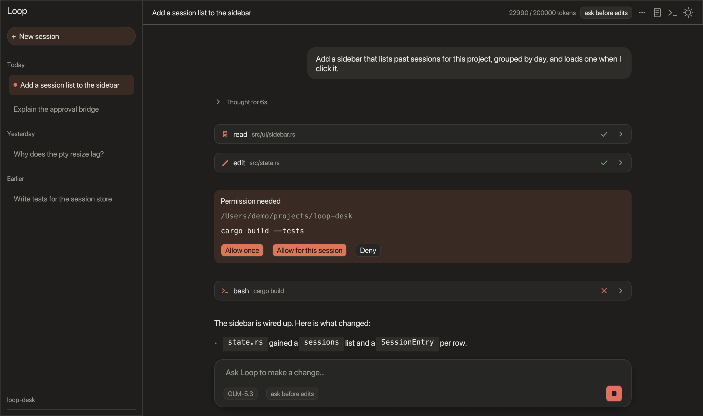

# loop-desk

A desktop app for the [Loop](https://github.com/soketlabs/loop) coding agent, written in Rust with egui. It looks and behaves like a chat-first
coding assistant: a session sidebar, a streaming conversation, collapsible tool cards, inline permission prompts, diffs, and a terminal dock.



## Features

- **Sessions:** every conversation is stored by Loop's session store. The sidebar lists them by day; click one to load its full history and continue it,
  or start a new one. Cmd+N new session, Cmd+[ / Cmd+] previous/next, Cmd+B hide the sidebar.
- **Chat:** streaming answers with Markdown (headings, lists, `inline code`, bold, italics, links, fenced code blocks with a Copy button),
  collapsible "Thought" rows, a Stop button, and auto-scroll that pauses when you scroll up.
- **Tool activity:** every tool call is a compact card (icon, name, summary, status) that expands to show its input and output.
- **Approvals:** tools that need permission show an inline card with *Allow once*, *Allow for this session* and *Deny*. A header chip switches the
  permission mode (read-only, ask, accept edits, full access).
- **Diffs:** edits show a coloured diff inside the card and in the **Changes** panel (Cmd+D), which lists every changed file.
- **Terminal:** a real shell in the project folder, docked right or bottom (Ctrl+`), with tabs, colours, scrollback, copy and paste.
- **Context compaction:** long sessions are compacted automatically at 90% of the model's window; a notice shows what happened.
- **Themes:** light and dark, following the system by default; the toggle in the header remembers your choice.
- Errors from the engine (for example a bad API key) show as a dismissible banner. The window title shows the session, project and git branch.

## Build and run

Needs the Rust toolchain (stable, via [rustup](https://rustup.rs)), git, and on Linux the usual GUI libraries
(`libxkbcommon`, `libwayland`, `libgl`). Loop's engine is fetched from `soketlabs/loop` (0.5.0, pinned in `Cargo.toml`);
the terminal panel lives in this repo (`loop-desk-term/`). The first build takes several minutes.

```bash
./run.sh /path/to/your/project   # opens the app on that folder
```

On first launch the app asks for an API key (Soket, OpenRouter or OpenAI). The key is checked, then stored in
`~/.loop/agent/auth.json`. Click the model chip under the composer to switch models or connect another provider.
A `SOKET_API_KEY` in the environment or in a `.env` file next to `run.sh` works too, and `LOOP_CODING_AGENT_DIR`
selects another Loop config folder. `./run-fresh.sh` starts with an empty config to see the first-run flow.

Review the layout without a window: `cargo run -- --demo [--dark] --screenshot out.png --width 1280 --height 760` renders a demo conversation to a PNG.

## Tests

```bash
cargo test                                   # unit and layout tests
SOKET_API_KEY=... cargo test live_prompt_roundtrip -- --ignored --nocapture   # talks to the real model
```

## How it is built

- `src/engine/` runs Loop's agent engine (`loop-app-core`, `loop-agent`) on a background task and turns its updates into UI events.
- `src/state.rs` holds plain data for the UI; `src/ui/` draws it (sidebar, chat, markdown, tool cards, diffs, composer, terminal dock).
- The terminal panel is the separate `loop-desk-term` crate (`portable-pty` + `vt100`).
- `SPEC.md`, `ENGINE_NOTES.md`, `EGUI_NOTES.md` and `VISUAL_REVIEW.md` are the specification and notes the app was built from.

## Credits

This app drives the Apache-2.0 licensed Loop engine from https://github.com/soketlabs/loop and adapts parts of the non-UI logic of Loop's own desktop
app (modified for egui). See `LICENSE`.
